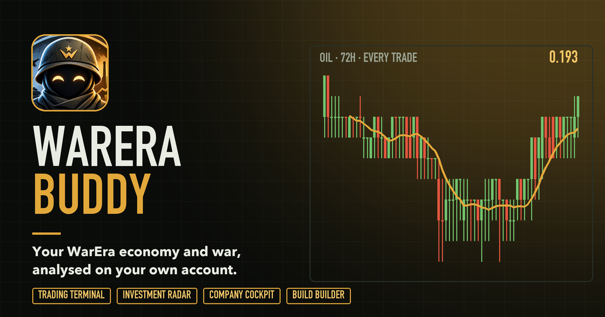
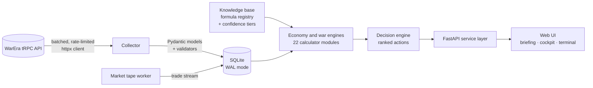

# WarEra Buddy

**A decision engine for the browser strategy game [WarEra](https://warera.io).** It doesn't ask what you want to do. It reads your account's live data, models your economy, and tells you what to do today.

> 🔒 **Source is private.** This repo documents the project: what it does, how it's built, and the engineering decisions behind it. Happy to walk through the code in an interview.

---

## At a glance

| | |
|---|---|
| **Size** | ~21k lines (Python backend, vanilla JS frontend) |
| **Tests** | 320+ pytest tests: formulas, collectors, models, web API |
| **Data** | Live game API (tRPC): companies, workers, regions, countries, parties, order books, trade tape |
| **Calculators** | 22 economy modules: production, upgrades, hiring, cash flow, supply chain, market depth, sell timing… |
| **Principle** | Every formula is registered with its source and a confidence tier, and checked against the live game |

## What it does

**Eco Mode**
- **Daily Briefing**: one ranked list of what to do today, with the reason and the money involved
- **Company Optimizer**: upgrade vs hire vs build, ranked by payback in days using *real* region/country/party bonuses
- **Market and Trading Terminal**: every trade over 72h, order-book depth, dip radar, buy/sell timing
- **Hiring**: wage offers to post, your open offers checked against the live market, break-even wage per worker
- **Treasury and Cash Reserve**: how much cash to keep, and what's free to invest
- **Reality Check**: the model's output, wages and prices vs your actual last 7 days of transactions

**War Mode**
- **Damage Calculator**: reproduces the in-game battle screen from your stats and every active battle's bonuses
- **Build Builder**: the best build you can afford at your level, with gear per slot from today's market
- **Eco → War**: what switching skill points really costs (resets, cooldowns, eco income given up)

## Architecture

- **Collector**: a tRPC client with batching (up to 50 calls per request), automatic chunking for larger batches, and retry/backoff
- **Validation layer**: every API response is parsed into typed Pydantic models, so a schema change in the game fails loudly instead of corrupting numbers
- **Engines**: pure, side-effect-free calculator functions. They're easy to test and easy to cross-check
- **Background workers**: market and trade-tape workers keep price history fresh for the charts and the dip radar

## Engineering decisions worth talking about

**"Unknown" is not zero.** When a join is missing (say a region's bonus wasn't collected), calculators return `None`, not `0`. The UI then says *"0% (assumed, not collected)"* or *"X% (real)"*, so the report never presents a guess as a fact.

**Formulas are verified, not assumed.** Production, upgrade-cost and bonus formulas were cross-checked against two independent sources on the same account. The steel-cost sequence, PP/day-per-level constant and concrete-per-slot formula all matched exactly.

**Root-cause fixes plus defence in depth.** A live run crashed on a 139-item batch (the API max is 50). The root cause was a scoping bug that collected every region in the game instead of only the account's. It was fixed at the source, then a chunking layer was added so no batch can exceed the limit again. A regression test reproduces the exact 139 → 50/50/39 split.

**Model vs reality.** The Reality Check page compares what the model predicted with what the account actually earned over the last 7 days. That turns model error into something you can see and fix.

## Status

In active development and used daily on a live account. The economy side is complete. War Mode is being verified against the game.

---

Built by <a href="https://github.com/moezkayy">@moezkayy</a>. Unofficial fan project. WarEra and its assets belong to their owners.
